# NewView FPV OSD Studio

**Design your own OSD font, or recolour one you already have, and see it live on real flight footage before it goes anywhere near your goggles.**

NewView FPV OSD Studio is a desktop app for Windows and macOS that builds custom on-screen display (OSD) fonts for Betaflight, INAV and ArduPilot. One click exports a complete font pack for Walksnail, HDZero, DJI (WTFOS), Caddx goggles, analog video and the [SNEAKY_FPV](https://sites.google.com/view/sneaky-fpv/home) OSD Overlay tool.

Current version: **v2.4** (tester / review release). A personal licence key is required. See [Getting a licence key](#getting-a-licence-key).

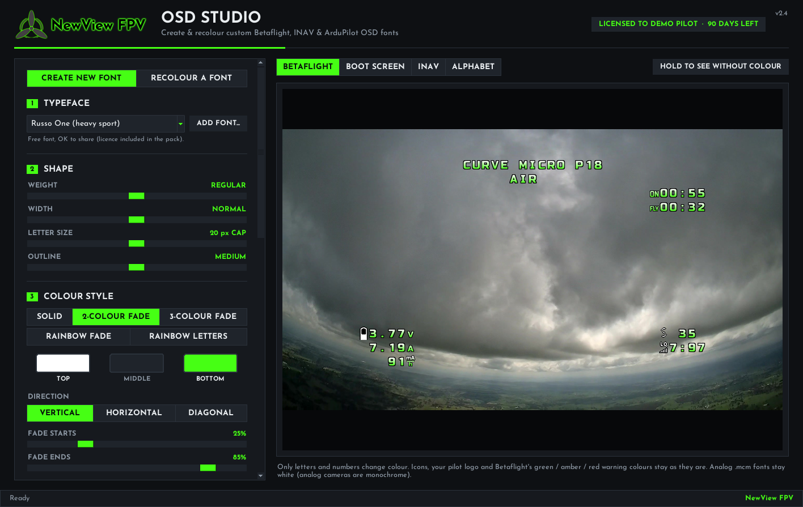

---

## Features

### Create a new font
- **37 bundled typefaces**, from clean and readable (Saira, Russo One) to sci-fi HUD (Orbitron, Audiowide), stencil, retro arcade, brush and graffiti styles. Every bundled typeface is free to share, and its licence is included in each pack.
- **Use your own typeface.** Add any `.ttf` or `.otf` file with **ADD FONT...**.
- **Shape controls** for weight, width, letter size and outline thickness.
- **Colour styles:** solid, 2-colour fade, 3-colour fade, rainbow fade and rainbow letters, with vertical, horizontal or diagonal direction and adjustable fade start and end points.
- **One-click colour presets** (NewView, Fire, Ice, Ocean, Gold, Sunset, Purple Haze and more). Save your own with **+ SAVE AS PRESET**.
- **Pilot logo** on the boot screen and as the INAV pilot logo: the NewView FPV logo, your own name and callsign as text, your own picture, or the stock logo.

### Recolour an existing font
- The app finds the font packs already in your Downloads, Desktop and Documents folders, or you can browse to one.
- Apply any colour style or preset, then export under a new name.
- **Hold to compare** switches the preview back to the original so you can see the difference instantly.

### Live preview on real footage
- Preview tabs for a **Betaflight** flight, the **boot screen**, an **INAV** flight and the **full alphabet**.
- Only letters and numbers change colour. Icons, your pilot logo and Betaflight's green / amber / red warning colours stay as they are, exactly as they will in the air.

### Export everything at once
Tick the systems you fly and press **CREATE FONT**. Each target gets its own folder, ready to copy to an SD card or upload:

| Export target | What you get | Where it goes |
|---|---|---|
| Walksnail | `userfont` folder | Goggles SD card, then pick the font in the goggles' OSD font menu |
| HDZero | `.bmp` font files | `resource\OSD\FC\` on the goggles SD card |
| DJI (WTFOS / msp-osd) | `font_*.png` files | Root of the goggles SD card |
| Analog | `.mcm` file | Betaflight / INAV Configurator, OSD tab, Font Manager |
| Caddx goggles | Font files plus ReadMe | **COPY CADDX FONT TO SD CARD...** button in the app |
| [SNEAKY_FPV](https://sites.google.com/view/sneaky-fpv/home) OSD Overlay | Installed automatically | When the option is ticked |

A ready-to-share zip pack can be made at the same time.

---

## Firmware support

| Firmware | Status in v2.4 |
|---|---|
| **Betaflight** | Supported on all export targets. Every target passes the font pack validator (firmware loader rules, decode-back check against the stock icons, comparison with a control pack). |
| **INAV** | Supported on all export targets, including INAV HD icon sets. Passes the same validator checks. |
| **ArduPilot (HD)** | New in v2.4. Packs include ArduPilot-named files for DJI WTFOS (`font_ardu*.png`) and HDZero (`ARDU_000.bmp` / `ARDU_FHD_000.bmp`), plus a ReadMe. The flight controller needs `MSP_OPTIONS` set so ArduPilot uses Betaflight-compatible symbol codes (see the ReadMe in the pack). These files were checked against the ArduPilot, msp-osd and HDZero source code but **have not yet been tested on real hardware**. |
| **ArduPilot (analog)** | **Not supported yet.** Analog ArduPilot needs its own `.bin` font layout, which the app does not produce. |

Notes:
- Analog OSD chips are black and white only, so colours show on HD systems only.
- Betaflight 4.5 and later: to see coloured warnings, set `displayport_msp_fonts = 0,1,2,3`.

---

## Screenshots

| | |
|---|---|
| 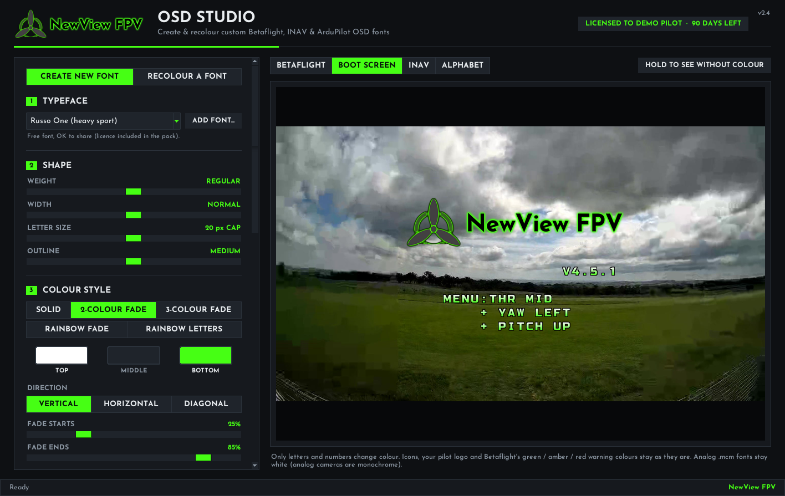 Boot screen preview with pilot logo | 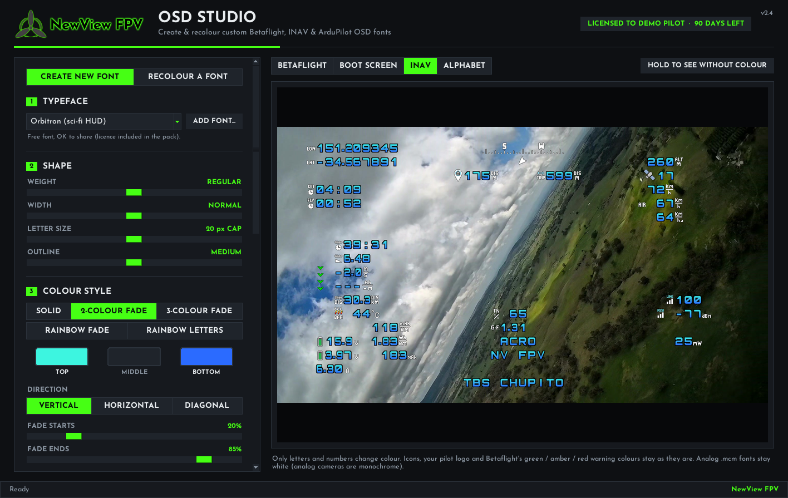 INAV flight preview |
| 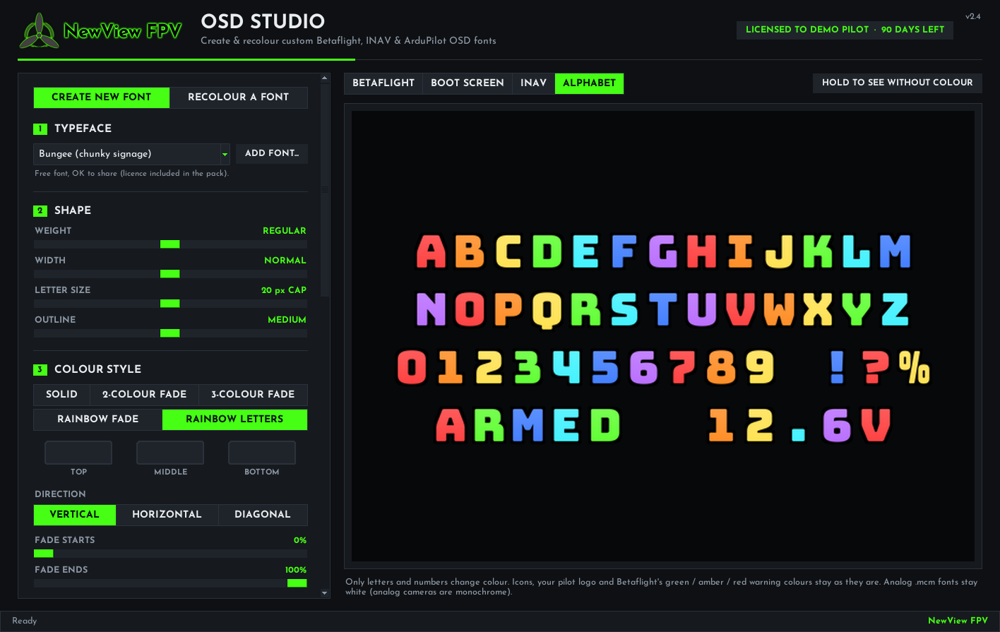 Full alphabet, rainbow letters | 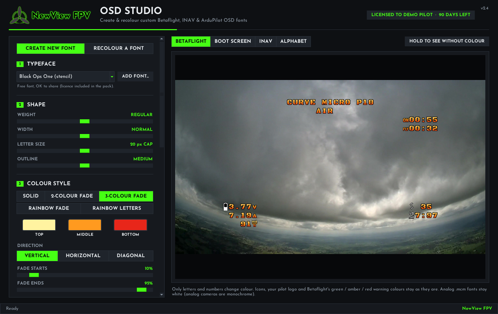 One-click colour presets |
| 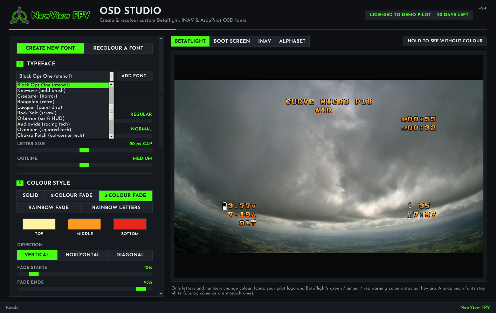 37 bundled typefaces | 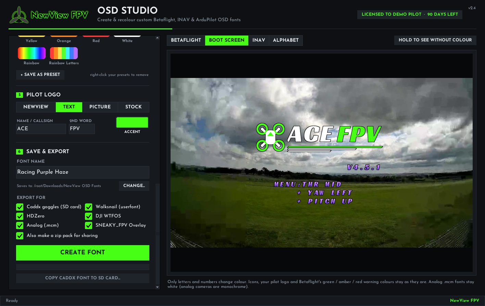 Your own pilot logo |
| 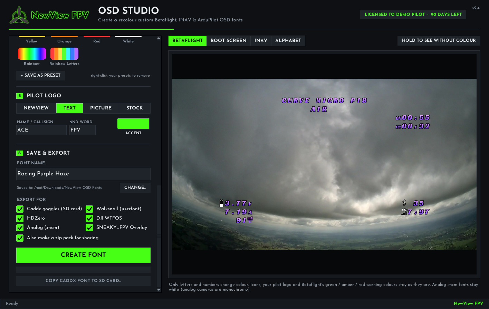 Export for every system at once | 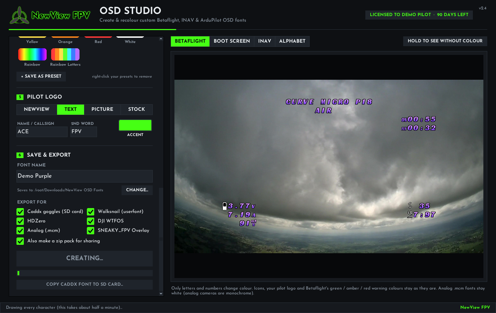 Building the font pack |
| 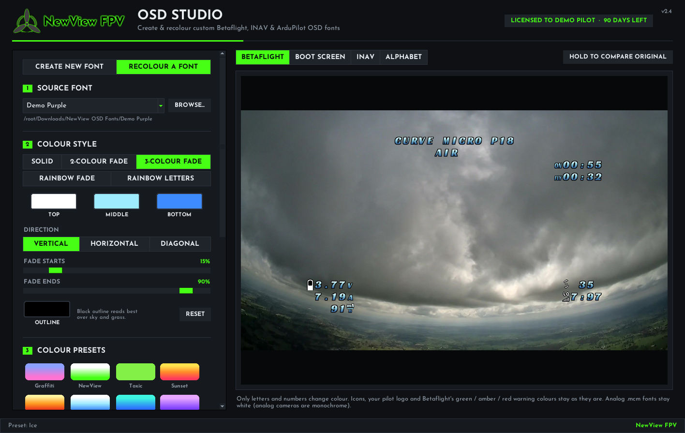 Recolour an existing font | 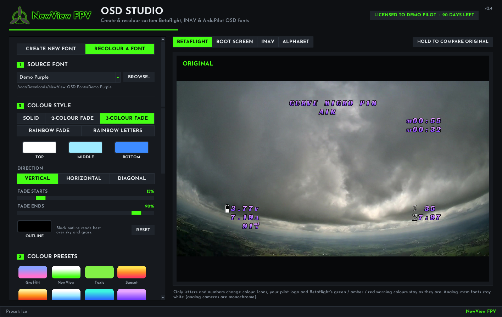 Hold to compare with the original |

---

## Download and install

Download the latest build from the **[Releases](../../releases)** page.

### Windows (10 or 11)
1. Download **NewView OSD Studio v2.4 - Windows.zip** and unzip it somewhere permanent, such as Documents or the Desktop. Keep the whole folder together.
2. Double-click **Start NewView OSD Studio**.
3. If Windows shows "Windows protected your PC", click **More info**, then **Run anyway**. (The app is not yet signed with a Microsoft certificate.)

Nothing else needs installing. Python and every library the app uses are included in the folder.

### macOS (10.13 or newer, Apple Silicon or Intel)
1. Download **NewView OSD Studio v2.4 - Mac.zip**, unzip it and drag **NewView OSD Studio.app** into Applications.
2. The first time only, right-click (or Control-click) the app and choose **Open**, then **Open** again. On newer macOS, open **System Settings > Privacy & Security** and click **Open Anyway** next to NewView OSD Studio.

> The Mac build is packaged from the same source as the Windows build, but v2.4 has not yet been run on a Mac. Please report any problems.

Full instructions are in **OSD Studio - User Manual.pdf**, included in both downloads.

---

## Getting a licence key

The first time the app opens, it shows an activation screen with your **Computer ID**.

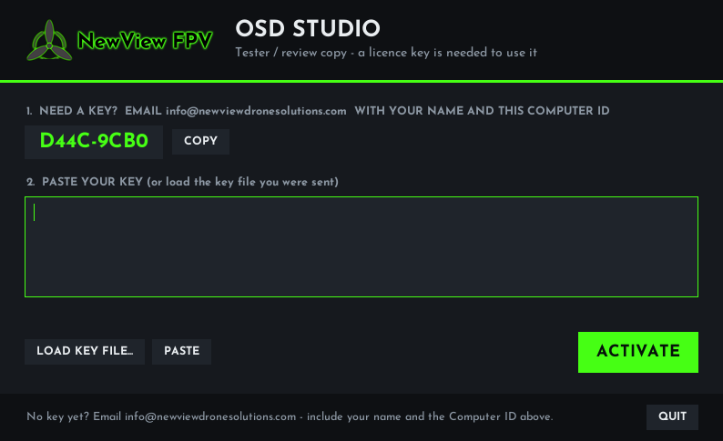

1. Email **info@newviewdronesolutions.com** with your name and the Computer ID (the **COPY** button copies it for you).
2. When your key arrives, paste the whole key (it starts with `NVOSD-`) and click **ACTIVATE**, or click **LOAD KEY FILE...** and choose the `.nvkey` file you were sent.

The app remembers your key on that computer. The badge at the top right shows who the copy is licensed to and how many days are left. Each key is issued to one person; please do not share the app or your key.

---

## Reporting a problem

If something goes wrong, the app saves the error details to a file and tells you where it is. Please email that file and a screenshot to **info@newviewdronesolutions.com**. Feedback and feature ideas are very welcome at the same address.

---

## For developers

- Python 3.12 with Tkinter, Pillow and NumPy. Entry point: `app/osd_studio.py`.
- The bundled Python runtimes and the release zips are not stored in this repository. Release zips are attached to GitHub Releases.
- Main modules: `studio_window.py` (interface), `osd_engine.py` and `generator/` (font building), `font_maker.py`, `ui_kit.py`, `version.py`.

## Licence and credits

Thanks to **[SNEAKY_FPV](https://sites.google.com/view/sneaky-fpv/home)**, creator of the SNEAKY_FPV OSD Overlay tool, which OSD Studio can install fonts into directly.

NewView FPV OSD Studio is proprietary software © New View Drone Solutions. All rights reserved.

Bundled typefaces are used under the SIL Open Font License 1.1 or the Apache License 2.0; each typeface's licence file is in `app/generator/ttf/` and is copied into every font pack the app makes. Betaflight, INAV, ArduPilot, Walksnail, HDZero, DJI, Caddx and SNEAKY_FPV are names of their respective owners and are used only to describe compatibility.

**NewView FPV** by New View Drone Solutions  
Website: https://www.newviewdronesolutions.com/  
Instagram: https://www.instagram.com/newviewfpv  
YouTube: https://www.youtube.com/@NewViewFPV  
Discord: bigredfpv  
Contact: info@newviewdronesolutions.com
